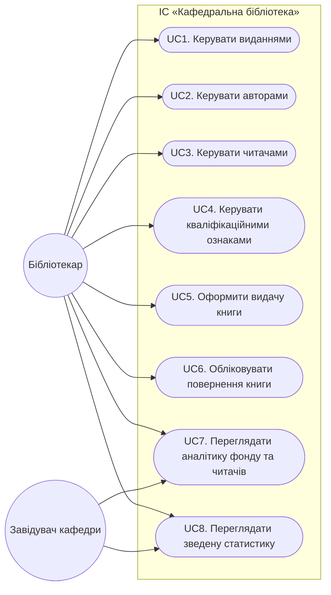

# Діаграма прецедентів ІС "Кафедральна бібліотека"

## Актори

| Актор | Роль |
|-------|-------|
| **Бібліотекар** | основний користувач системи: введення даних, видачі, імпорт |
| **Завідувач кафедри** | перегляд аналітики складу читачів і фондів (динаміка змін) |

> У вебінтерфейсі обидва актори працюють з однією системою; розділення ролей логічне (за сценаріями використання).

## Діаграма

